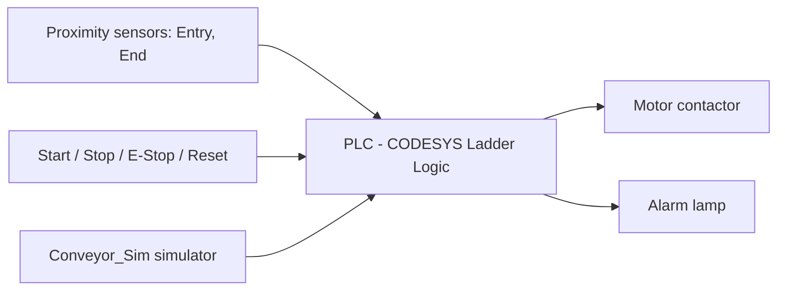

# Conveyor Belt Automation (PLC)

A conveyor belt controller built in **CODESYS V3.5** using **Ladder Logic**. Proximity sensors detect items at the entry and end of the belt, and the PLC controls the motor with Start / Stop, a fail-safe Emergency Stop, jam detection and an item counter. A belt simulator lets the whole system run and be tested without hardware.

 

## Features

- Start / Stop with a motor seal-in circuit
- Belt stops automatically when an item reaches the end sensor
- **Fail-safe Emergency Stop** (normally closed wiring) with a latched fault and manual reset
- **Jam detection:** entry sensor blocked for 5 s while the motor runs stops the belt and raises an alarm
- Item counter (CTU) with reset
- Alarm output for emergency and jam faults
- Belt simulator program for testing without hardware

## Skills demonstrated

Ladder Logic · Seal-in circuits · Fail-safe emergency stop logic · Latched faults · TON timers · CTU counters · Proximity sensor interfacing · Interlocks · Simulation and testing

## System overview

## I/O list

| Name | Type | Direction | Description |
|---|---|---|---|
| `Prox_Start` | BOOL | Input | TRUE when an item is at the entry |
| `Prox_End` | BOOL | Input | TRUE when an item is at the end |
| `Start_PB` | BOOL | Input | Start button |
| `Stop_PB` | BOOL | Input | Stop button |
| `E_Stop_OK` | BOOL | Input | TRUE = normal, FALSE = emergency stop pressed |
| `Reset_PB` | BOOL | Input | Clears emergency and jam faults |
| `Count_Reset` | BOOL | Input | Resets the item counter |
| `Motor` | BOOL | Output | Motor contactor |
| `Alarm` | BOOL | Output | Alarm lamp / horn |

`Prox_Start` and `Prox_End` are driven by `Conveyor_Sim` in simulation. On real hardware they map to physical inputs (for example `%IX0.0`, `%IX0.1`).

## Control logic (6 rungs)

| Rung | Logic | Purpose |
|---|---|---|
| 1 | `(NOT E_Stop_OK) OR (Emergency AND NOT Reset_PB)` → `Emergency` | Latched emergency stop |
| 2 | `Prox_Start AND Motor` → TON `JamTimer` (T#5S) → `Jam_Detected` | Jam timer |
| 3 | `(Jam_Detected OR Jam_Fault) AND NOT Reset_PB` → `Jam_Fault` | Latched jam fault |
| 4 | `(Start_PB OR Motor) AND NOT Stop_PB AND NOT Prox_End AND NOT Emergency AND NOT Jam_Fault` → `Motor` | Motor control with seal-in |
| 5 | `Prox_Start` → CTU `Item_Counter` (RESET = `Count_Reset`, PV = 100) | Item counter |
| 6 | `Emergency OR Jam_Fault` → `Alarm` | Alarm |

An equivalent Structured Text version is in [`src/PLC_PRG_equivalent.st`](src/PLC_PRG_equivalent.st).

### Design decisions

- **Normally closed E-stop signal:** `E_Stop_OK` is TRUE when healthy. A broken wire drops it to FALSE and stops the belt (fail-safe).
- **Latched emergency:** the first branch of Rung 1 stays TRUE while the E-stop is pressed, so Reset has no effect until the E-stop is released. The belt cannot restart while the emergency still exists.
- **Seal-in:** the `Motor` contact in parallel with `Start_PB` keeps the motor running after Start is released.
- **Jam timer:** an item should leave the entry sensor quickly. A sensor blocked for 5 s while the motor runs means something is stuck.
- **Counter:** a CTU counts each rising edge on the entry sensor, so every item is counted once.

## Simulator

`Conveyor_Sim` moves one item along the belt only while the motor runs, and turns the two sensors on at the entry and end zones. Control it from the watch list with *Prepare value*:

| Variable | Effect |
|---|---|
| `Conveyor_Sim.Spawn_PB` | Puts an item at the entry |
| `Conveyor_Sim.Remove_PB` | Removes the item |
| `Conveyor_Sim.Stuck` | Freezes the item to test the jam alarm |

## Test results

Nine test cases are in [`docs/Test_Cases.md`](docs/Test_Cases.md): start, stop, item travel, end stop, restart, emergency stop, reset blocked, reset, and jam.

## How to run

1. Install **CODESYS V3.5 SP22** (or later) from codesys.com.
2. Open the project from [`project/`](project/) (or import the PLCopenXML file).
3. **Build → Build**, then **Online → Login → Yes**, then press **F5**.
4. Set values in the watch list: double-click a **Prepare** cell, then press **Ctrl+F7** to write.

## Possible improvements

- Exit sensor that counts items leaving the belt
- Start-up warning horn for 3 s before the motor runs
- Motor overload input and a "failed to start" alarm
- Speed selection with a VFD output

## License

MIT
